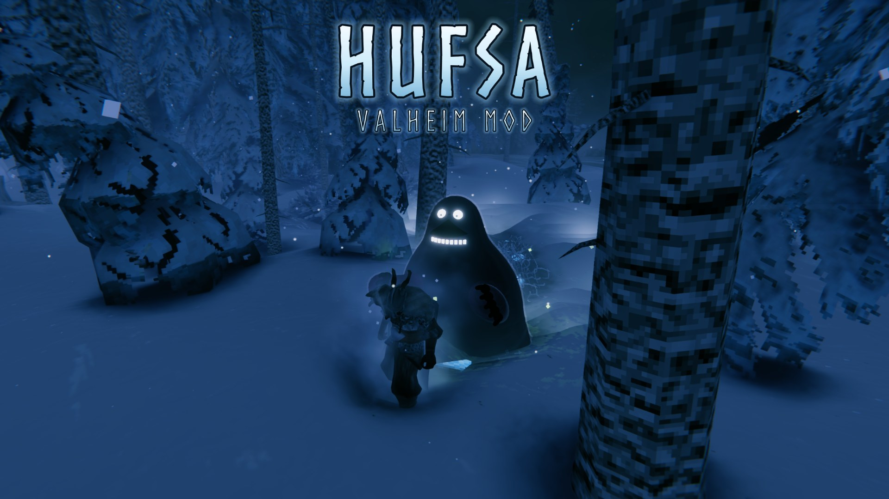

# Hufsa (Valheim mod)

Something cold walks the forests at night. BepInEx + Jotunn mod for Valheim.

The player-facing description is the store page: [thunderstore/README.md](thunderstore/README.md).

## Build

```
%LOCALAPPDATA%\Microsoft\dotnet\dotnet.exe build -c Release
```

The build copies the mod into the Thunderstore "Default" profile at `BepInEx\plugins\Hufsa` (paths in `Hufsa.csproj`).
`tools\package.ps1` makes the Thunderstore zip in `dist\`.

## Release

Every push to `main` runs [.github/workflows/release.yml](.github/workflows/release.yml):

1. Takes the version from `thunderstore/manifest.json`; if that version was already released, bumps the patch number.
2. Builds against the Valheim dedicated server's libraries (downloaded with SteamCMD) plus BepInEx and Jotunn.
3. Packages the zip and attaches it to a GitHub Release (`vX.Y.Z`).
4. Publishes to Thunderstore if the `THUNDERSTORE_TOKEN` secret and `THUNDERSTORE_TEAM` variable are set.

For a new minor or major version, edit `version_number` in `thunderstore/manifest.json`.

## Testing in game

Console (F5), after `devcommands`:

- `hufsa watcher` / `hufsa hunter`: spawn one near you
- `hufsa testmode`: Watchers keep coming, pinned on the map
- `hufsa dread [n]`: show or set your Watcher sightings
- `hufsa weather`: current weather and whether Hufsa can appear here
- `freefly`: photo hold, Hufsa stands still and can't be spotted
